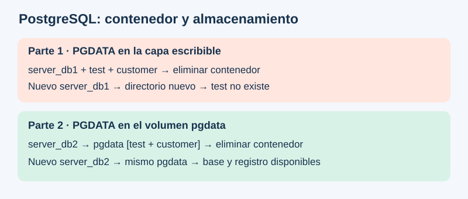
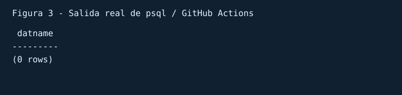
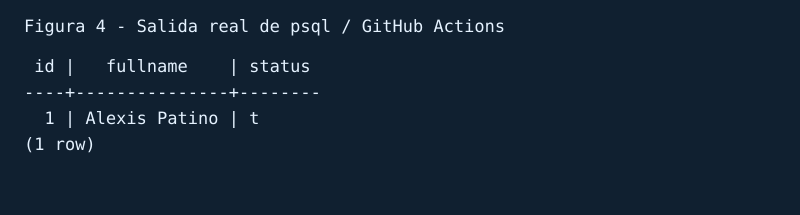

# Práctica No. 3: Volúmenes para persistir una base de datos PostgreSQL

**Estudiante:** Alexis Patiño  
**Curso:** 4to ciclo  
**Fecha:** 26 de octubre de 2026  
**Estado:** Práctica ejecutada y verificada en GitHub Actions con Docker sobre Linux. Se utilizó psql como administrador de base de datos. Las figuras 2–5 reproducen las salidas reales de las consultas, no son capturas de una interfaz gráfica. [Ver ejecución completa](https://github.com/Alexisz3/tarea-Vol-menes-para-persistir-base-de-datos/actions/runs/40427245935).

## 1. Título

Persistencia de datos en PostgreSQL al recrear contenedores Docker, con y sin reutilización de volúmenes.

## 2. Tiempo de duración

Tiempo de ejecución automatizada de los comandos: **14 segundos (0,23 minutos)**, desde la descarga de la imagen hasta la verificación final. Este tiempo no incluye la preparación del informe ni la grabación del audio. Ejecución: 26 de octubre de 2026, 19:34, hora de Ecuador.

## 3. Fundamentos

Docker permite ejecutar aplicaciones dentro de contenedores a partir de imágenes. Una imagen contiene el software y la configuración inicial necesarios para iniciar un servicio. El contenedor es una instancia de esa imagen, con procesos y recursos propios. En esta práctica se emplea PostgreSQL, un sistema gestor de bases de datos relacional que permite organizar información en tablas y consultarla mediante SQL. La base `test` contendrá una tabla `customer`, destinada a almacenar un identificador, un nombre completo y un estado.

El ciclo de vida de un contenedor y el de sus datos deben analizarse por separado. Detener un contenedor conserva su sistema de archivos; iniciarlo nuevamente permite recuperar su estado. Eliminarlo y crear otro con el mismo nombre es una operación diferente: el nombre identifica al nuevo contenedor, pero no recupera automáticamente los archivos del anterior. La capa escribible del contenedor eliminado desaparece. Por ello, el nombre `server_db1` no constituye un mecanismo de persistencia ni un respaldo.

Existe un detalle relevante en la imagen oficial de PostgreSQL: para la versión 17, la ruta de datos predeterminada está declarada como volumen. Por tanto, ejecutar la imagen sin especificar `-v` puede crear un volumen anónimo. Al recrear el contenedor, Docker no vuelve a asociar automáticamente ese volumen anterior. La base puede dejar de verse aunque sus archivos permanezcan en un volumen sin utilizar. Para distinguir ambos fenómenos, esta práctica configura `PGDATA=/var/lib/postgresql/labdata` en la primera parte. Así, los archivos reales de PostgreSQL se escriben fuera del volumen anónimo predeterminado y se pierden al eliminar el contenedor.

En la segunda parte se crea el volumen con nombre `pgdata` y se monta en `/var/lib/postgresql/data`. El motor de Docker administra este almacenamiento de forma independiente del contenedor. Cuando se elimina `server_db2`, el volumen permanece. Al crear un nuevo contenedor y asociar el mismo volumen a la misma ruta, PostgreSQL encuentra el directorio inicializado y utiliza sus bases y tablas existentes. No es necesario insertar nuevamente los datos para comprobar su conservación.

La comprobación debe comparar el estado antes y después de recrear cada contenedor. Consultar el catálogo `pg_database` permite comprobar la existencia de `test`; consultar `customer` permite verificar el registro concreto. Estas verificaciones aportan evidencia más precisa que observar únicamente que el servidor inicia correctamente. Finalmente, un volumen no reemplaza las copias de seguridad: su eliminación, un fallo del almacenamiento o una modificación accidental también pueden provocar pérdida de información. Se recomienda complementar la persistencia con respaldos y pruebas de restauración.



**Figura 1.** Ciclo de vida del contenedor y del almacenamiento de PostgreSQL. Diagrama conceptual, no captura de una ejecución.

## 4. Conocimientos previos

- Uso de una terminal y comandos básicos de Docker.
- Diferencia entre imagen, contenedor y volumen.
- Conexiones PostgreSQL: servidor, puerto, usuario y contraseña.
- SQL básico: `CREATE DATABASE`, `CREATE TABLE`, `INSERT` y `SELECT`.
- Uso de Git y GitHub para publicar archivos Markdown.

## 5. Objetivos a alcanzar

- Crear los contenedores `server_db1` y `server_db2`.
- Crear la base `test`, la tabla `customer` y un registro de prueba.
- Comprobar la pérdida de datos al recrear un contenedor cuyo directorio de datos está en su capa escribible.
- Comprobar la conservación de la base y del registro al reutilizar `pgdata`.
- Documentar las verificaciones mediante consultas y capturas reales.

## 6. Equipo necesario

- Computador con Windows, Linux o macOS y Docker Engine operativo; en Windows, Docker Desktop configurado para contenedores Linux.
- Acceso a Internet para descargar `postgres:17`.
- Administrador PostgreSQL, por ejemplo DBeaver, DataGrip o TablePlus. Como alternativa de terminal se incluye `psql`, disponible dentro de la imagen.
- Puertos locales 5433 y 5434 disponibles.
- Cuenta y repositorio de GitHub.
- Micrófono o teléfono para grabar una reflexión personal en MP3 de al menos 60 segundos.

**Versiones reales:** Docker Engine 29.4.2; PostgreSQL 17.11 sobre Linux x86_64; cliente psql incluido en postgres:17. Se utilizó el runner ubuntu-latest de GitHub Actions. Ver [registro íntegro](evidencias/ejecucion.txt) y [versión PostgreSQL](evidencias/postgresql.txt).

## 7. Material de apoyo

- [Plantilla del informe](https://github.com/maguaman2/informe-tendencias/blob/main/informe.md).
- [Documentación de volúmenes Docker](https://docs.docker.com/engine/storage/volumes/).
- [Imagen oficial PostgreSQL](https://hub.docker.com/_/postgres).
- [Manual de psql](https://www.postgresql.org/docs/17/app-psql.html).
- Consigna TAS3 de la asignatura.

## 8. Procedimiento

Los comandos siguientes se ejecutan individualmente en PowerShell o en otra terminal. Las contraseñas son ejemplos exclusivos para esta práctica local. Si ya existen contenedores con esos nombres o un volumen `pgdata`, revisar su contenido antes de continuar y utilizar un entorno de laboratorio limpio. No borrar recursos ajenos a esta práctica.

### 8.1. Preparación

```powershell
docker version
docker pull postgres:17
docker ps -a
docker volume ls
```

Se utiliza la versión mayor 17 para mantener la ruta `/var/lib/postgresql/data` en la segunda parte. PostgreSQL 18 y posteriores cambian la organización predeterminada de los datos; no sustituir la etiqueta por `latest` sin adaptar los montajes.

### 8.2. Parte 1: PostgreSQL sin volumen para sus datos efectivos

**Paso 1. Crear el contenedor.**

```powershell
docker run -d --name server_db1 -e POSTGRES_PASSWORD=Practica3_Local -e PGDATA=/var/lib/postgresql/labdata -p 127.0.0.1:5433:5432 postgres:17
docker logs server_db1
docker exec server_db1 pg_isready -U postgres
```

Esperar a que `pg_isready` indique que acepta conexiones. Si todavía no está listo, repetir la comprobación.

**Paso 2. Conectar el administrador.** Crear una conexión PostgreSQL con los siguientes parámetros:

| Parámetro | Valor |
|---|---|
| Host | `localhost` |
| Puerto | `5433` |
| Usuario | `postgres` |
| Contraseña de laboratorio | `Practica3_Local` |
| Base inicial | `postgres` |

**Paso 3. Crear la base.** Ejecutar desde una consola SQL conectada a `postgres`, fuera de una transacción explícita:

```sql
CREATE DATABASE test;
```

Alternativa desde terminal:

```powershell
docker exec server_db1 psql -U postgres -d postgres -v ON_ERROR_STOP=1 -c "CREATE DATABASE test;"
```

**Paso 4. Cambiar la conexión a `test`, crear la tabla e insertar un registro.**

```sql
CREATE TABLE customer (
    id INTEGER GENERATED ALWAYS AS IDENTITY PRIMARY KEY,
    fullname VARCHAR(150) NOT NULL,
    status BOOLEAN NOT NULL DEFAULT TRUE
);
INSERT INTO customer (fullname, status) VALUES ('Alexis Patino', TRUE);
SELECT id, fullname, status FROM customer ORDER BY id;
```

Alternativa desde terminal, después de crear la base:

```powershell
docker exec server_db1 psql -U postgres -d test -v ON_ERROR_STOP=1 -c "CREATE TABLE customer (id INTEGER GENERATED ALWAYS AS IDENTITY PRIMARY KEY, fullname VARCHAR(150) NOT NULL, status BOOLEAN NOT NULL DEFAULT TRUE); INSERT INTO customer (fullname, status) VALUES ('Alexis Patino', TRUE); SELECT id, fullname, status FROM customer ORDER BY id;"
```

Usar el administrador o la alternativa de terminal para crear objetos; no repetir ambos caminos sobre la misma base.


**Figura 2.** Salida real de psql: registro inicial en server_db1. [Texto original](evidencias/figura2.txt).

**Paso 5. Revisar dónde se almacenan los datos.**

```powershell
docker exec server_db1 psql -U postgres -d postgres -c "SHOW data_directory;"
docker inspect server_db1 --format '{{json .Mounts}}'
```

El directorio de datos esperado es `/var/lib/postgresql/labdata`. La imagen puede generar un montaje anónimo en `/var/lib/postgresql/data`; ese montaje no contiene el directorio efectivo elegido para este ensayo.

**Paso 6. Detener, eliminar y recrear.** `docker rm -v` elimina también el volumen anónimo asociado; no se ha creado un volumen con nombre en esta parte.

```powershell
docker stop server_db1
docker rm -v server_db1
docker run -d --name server_db1 -e POSTGRES_PASSWORD=Practica3_Local -e PGDATA=/var/lib/postgresql/labdata -p 127.0.0.1:5433:5432 postgres:17
docker exec server_db1 pg_isready -U postgres
```

Esperar nuevamente a que el servicio acepte conexiones.

**Paso 7. Reconectar a `postgres` y comprobar.** Actualizar la lista de bases en el administrador y ejecutar:

```sql
SELECT datname FROM pg_database WHERE datname = 'test';
```

Alternativa de terminal:

```powershell
docker exec server_db1 psql -U postgres -d postgres -c "SELECT datname FROM pg_database WHERE datname = 'test';"
```

Resultado esperado: cero filas. No crear `test` otra vez antes de esta comprobación.



**Figura 3.** La consulta al catálogo devuelve cero filas: test no existe. [Texto original](evidencias/figura3.txt).

### 8.3. Parte 2: PostgreSQL con volumen persistente

**Paso 8. Crear el volumen y el contenedor.** Para este ensayo, `pgdata` debe ser nuevo o estar vacío.

```powershell
docker volume create pgdata
docker run -d --name server_db2 -e POSTGRES_PASSWORD=Practica3_Local -p 127.0.0.1:5434:5432 --mount type=volume,source=pgdata,target=/var/lib/postgresql/data postgres:17
docker exec server_db2 pg_isready -U postgres
docker inspect server_db2 --format '{{json .Mounts}}'
```

Comprobar que `Mounts` contiene el volumen `pgdata` con destino `/var/lib/postgresql/data`. Esperar a que PostgreSQL acepte conexiones.

**Paso 9. Conectar y crear los datos.** En el administrador utilizar `localhost`, puerto `5434`, usuario `postgres`, contraseña `Practica3_Local` y base inicial `postgres`. Ejecutar `CREATE DATABASE test;`; después abrir una conexión a `test` y ejecutar el SQL del paso 4.

Alternativa completa desde terminal:

```powershell
docker exec server_db2 psql -U postgres -d postgres -v ON_ERROR_STOP=1 -c "CREATE DATABASE test;"
docker exec server_db2 psql -U postgres -d test -v ON_ERROR_STOP=1 -c "CREATE TABLE customer (id INTEGER GENERATED ALWAYS AS IDENTITY PRIMARY KEY, fullname VARCHAR(150) NOT NULL, status BOOLEAN NOT NULL DEFAULT TRUE); INSERT INTO customer (fullname, status) VALUES ('Alexis Patino', TRUE); SELECT id, fullname, status FROM customer ORDER BY id;"
```



**Figura 4.** Registro antes de eliminar server_db2. [Montaje real pgdata](evidencias/montaje.txt) y [consulta original](evidencias/figura4.txt).

**Paso 10. Eliminar únicamente el contenedor y reutilizar el volumen.**

```powershell
docker stop server_db2
docker rm server_db2
docker volume inspect pgdata
docker run -d --name server_db2 -e POSTGRES_PASSWORD=Practica3_Local -p 127.0.0.1:5434:5432 --mount type=volume,source=pgdata,target=/var/lib/postgresql/data postgres:17
docker exec server_db2 pg_isready -U postgres
```

No ejecutar `docker volume rm pgdata`: se necesita conservar ese almacenamiento. Esperar a que el servicio esté listo. La variable de contraseña no vuelve a configurar un directorio ya inicializado.

**Paso 11. Verificar la persistencia.** Reconectar el administrador a `test` en el puerto `5434` y consultar `customer`. No volver a ejecutar `CREATE DATABASE`, `CREATE TABLE` ni `INSERT`.

```powershell
docker exec server_db2 psql -U postgres -d postgres -c "SELECT datname FROM pg_database WHERE datname = 'test';"
docker exec server_db2 psql -U postgres -d test -c "SELECT id, fullname, status FROM customer ORDER BY id;"
```

Resultado esperado: una fila con `test` en la primera consulta y el registro original en la segunda. `psql` representa el booleano verdadero como `t`; otros clientes pueden mostrar `true`.


**Figura 5.** Registro original conservado después de recrear server_db2. [Consulta original](evidencias/figura5.txt) y [comprobación de test](evidencias/base-persistente.txt).

Las imágenes tienen 800 px de ancho y se generaron directamente a partir de las salidas de psql guardadas durante la ejecución. Se conservan los archivos de texto para contrastarlas. La práctica se realizó mediante terminal; no se utilizó DataGrip ni TablePlus. Si el docente exige capturas de pantalla de un cliente gráfico, esas capturas deben añadirse como evidencia complementaria.

## 9. Resultados esperados

| Comprobación | Sin volumen en el directorio efectivo | Con volumen `pgdata` |
|---|---|---|
| Existe `test` antes de eliminar | Sí | Sí |
| Existe el registro antes de eliminar | Sí | Sí |
| Existe `test` después de recrear | No | Sí |
| Se recupera el registro original | No | Sí |
| Verificación ejecutada en este informe | Correcta | Correcta |

**Resultados observados:** después de recrear server_db1, la consulta de test devolvió `(0 rows)`. Después de recrear server_db2, test permaneció y customer conservó exactamente el registro `1 | Alexis Patino | t`. El flujo comprobó automáticamente ambos resultados y terminó correctamente. No se reinsertaron datos tras recrear server_db2.

**Conclusión:** las consultas confirmaron que reutilizar el volumen pgdata conserva la base y el registro al recrear el contenedor. El nombre server_db1 no recuperó los archivos eliminados de su capa escribible. Por tanto, la persistencia depende del almacenamiento utilizado y de volver a montarlo correctamente. El volumen debe complementarse con respaldos.

### Lista para la entrega

- [x] Completar nombre, curso, duración y versiones reales.
- [x] Ejecutar ambas partes y registrar los resultados observados.
- [x] Añadir las figuras 2–5 con salidas reales de terminal y sus textos originales.
- [ ] Grabar una reflexión propia en MP3 y comprobar que dura al menos 60 segundos.
- [x] Subir el informe, el diagrama y las evidencias al repositorio GitHub.
- [ ] Entregar el enlace de este archivo en GitHub y adjuntar el MP3 en la plataforma de la asignatura.

## 10. Bibliografía

Docker, Inc. (s. f.). *Volumes*. Docker Docs. https://docs.docker.com/engine/storage/volumes/

Docker Official Images. (s. f.). *postgres*. Docker Hub. https://hub.docker.com/_/postgres

PostgreSQL Global Development Group. (s. f.). *psql — PostgreSQL interactive terminal*. PostgreSQL 17 documentation. https://www.postgresql.org/docs/17/app-psql.html

Maguaman2. (s. f.). *informe-tendencias* [Plantilla de informe]. GitHub. https://github.com/maguaman2/informe-tendencias