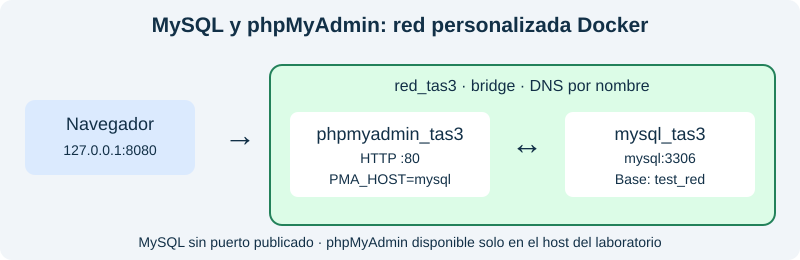
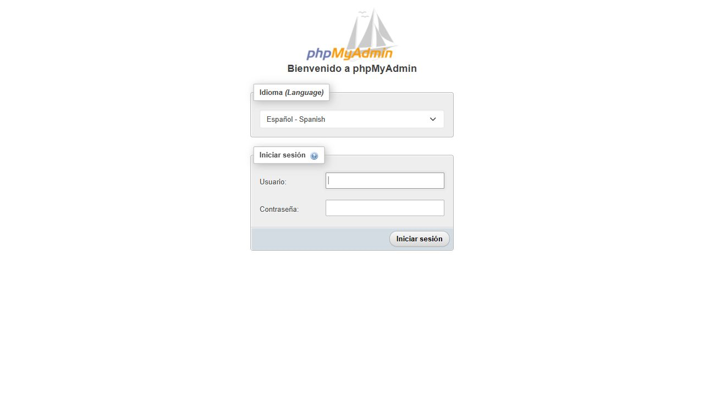
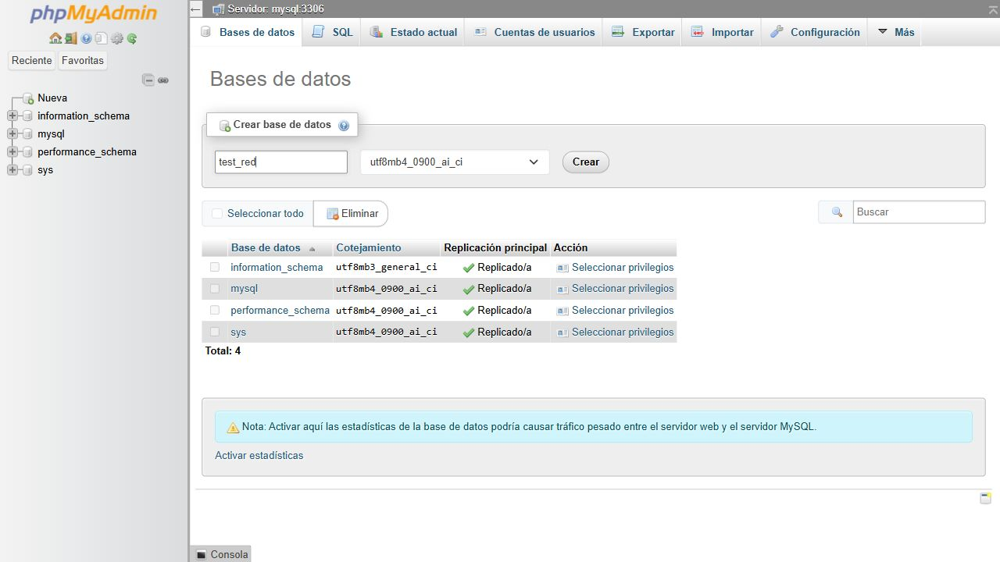
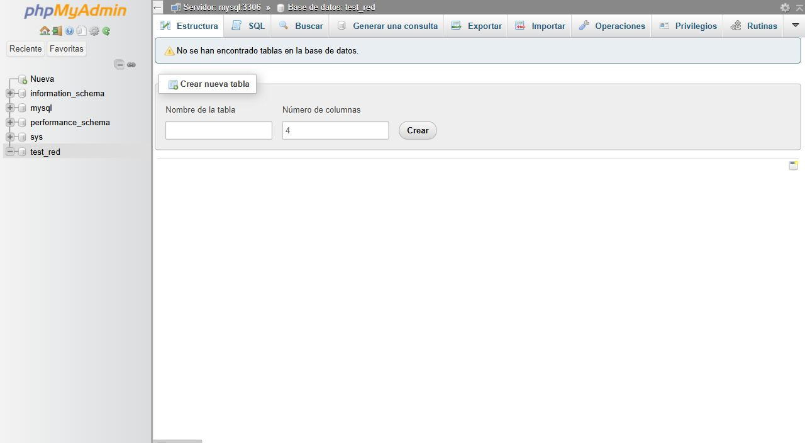

# Práctica 3: MySQL y phpMyAdmin en una red Docker

**Estudiante:** Alexis Patiño  
**Curso:** 4to ciclo  
**Fecha:** 2 de noviembre de 2026

## 1. Título

Comunicación entre un contenedor MySQL y un contenedor phpMyAdmin mediante una red personalizada de Docker.

## 2. Tiempo de duración

La ejecución local, desde el inicio de la descarga de imágenes hasta la comprobación final, duró **3 minutos y 4 segundos**: del 2 de noviembre de 2026 a las 11:52:48 hasta las 11:55:52, hora de Ecuador. No incluye la instalación previa de WSL y Docker ni la redacción del informe. Las marcas UTC originales están en [inicio.txt](evidencias-local/inicio.txt) y [fin.txt](evidencias-local/fin.txt).

## 3. Fundamentos

Docker permite ejecutar aplicaciones en contenedores separados. Una imagen incluye el software necesario para iniciar una aplicación, mientras que un contenedor representa su ejecución. Separar MySQL de phpMyAdmin permite identificar la responsabilidad de cada servicio: MySQL almacena y consulta la información, y phpMyAdmin proporciona una interfaz web para administrarla. Aunque ambos contenedores pueden ejecutarse en el mismo equipo, requieren una conexión de red para intercambiar solicitudes y respuestas.

MySQL es un sistema gestor de bases de datos relacional. Organiza los datos mediante bases, tablas y relaciones, y utiliza SQL para definir estructuras y consultar información. Para acceder al servidor se necesita una cuenta con permisos suficientes. En este laboratorio se utiliza una contraseña de demostración para la cuenta root. Esta cuenta permite crear la base de prueba; en un sistema real convendría utilizar cuentas con permisos limitados según las tareas de cada aplicación.

phpMyAdmin es una aplicación escrita en PHP que permite administrar MySQL desde el navegador. Sus formularios traducen acciones como crear una base de datos en operaciones enviadas al servidor. phpMyAdmin no sustituye a MySQL y tampoco almacena por sí mismo las bases administradas. Las credenciales introducidas en su pantalla de acceso corresponden al servidor MySQL. Por ello, si el nombre del servidor, el puerto o la contraseña son incorrectos, la interfaz no puede realizar las operaciones solicitadas.

Una red bridge personalizada permite conectar ambos contenedores dentro del mismo host Docker. Esta red incorpora resolución de nombres, de manera que phpMyAdmin puede localizar MySQL mediante el nombre de servicio `mysql`. No es necesario fijar una dirección IP, que podría cambiar al recrear el contenedor. La variable PMA_HOST indica ese destino y PMA_PORT establece el puerto interno 3306 utilizado por MySQL.

El navegador accede a phpMyAdmin a través de un puerto publicado. En este caso, el puerto 8080 del host se dirige al puerto 80 del contenedor web y se limita a la dirección local 127.0.0.1. MySQL no publica su puerto hacia el exterior: la comunicación con phpMyAdmin ocurre dentro de la red Docker. Además, localhost dentro de un contenedor se refiere a ese mismo contenedor; no representa al servidor MySQL ubicado en otro servicio.

Docker Compose permite describir esta configuración en un archivo declarativo. La comprobación de salud de MySQL evita iniciar la prueba antes de que el servidor pueda atender consultas. Finalmente, crear la base desde el formulario de phpMyAdmin y verificarla desde MySQL demuestra que existe comunicación funcional entre los servicios, más allá de que ambos contenedores aparezcan como iniciados.



**Figura 1.** Comunicación del navegador con phpMyAdmin y de phpMyAdmin con MySQL.

## 4. Conocimientos previos

- Imágenes, contenedores, puertos y redes Docker.
- Uso de terminal y archivos YAML.
- Autenticación y bases de datos MySQL.
- Navegación por formularios web.
- Publicación de informes Markdown en GitHub.

## 5. Objetivos a alcanzar

- Crear un contenedor MySQL con credenciales definidas.
- Crear un contenedor phpMyAdmin con el destino MySQL configurado.
- Conectar ambos servicios mediante la red bridge `red_tas3`.
- Crear `test_red` utilizando la interfaz de phpMyAdmin.
- Confirmar la existencia de la base mediante una consulta independiente a MySQL.

## 6. Equipo necesario

- Computadora personal con Windows 10 Enterprise LTSC, compilación 19044, procesador Intel Core i5-1035G1 y 8 GB de RAM.
- WSL 2 versión 3.0.3, Ubuntu 24.04.5 LTS y kernel Linux 6.18.54.1-microsoft-standard-WSL2.
- Docker Engine 29.9.2 y Docker Compose 5.7.0 instalados localmente dentro de WSL.
- Imágenes `mysql:8.4` y `phpmyadmin:5.2.3`.
- Navegador de Windows para acceder a phpMyAdmin.

La práctica documentada se ejecutó en la computadora personal mediante WSL 2, sin utilizar VirtualBox. El navegador accedió al servicio local 127.0.0.1:8080. Los contenedores se dejaron disponibles para revisarlos y se incluyeron archivos para iniciarlos o detenerlos. Las evidencias anteriores de GitHub Actions se conservan como antecedente en otra carpeta; las evidencias de esta ejecución están en `evidencias-local/`.

## 7. Material de apoyo

- [Imagen oficial MySQL](https://hub.docker.com/_/mysql).
- [Imagen oficial phpMyAdmin](https://hub.docker.com/_/phpmyadmin).
- [Redes bridge de Docker](https://docs.docker.com/engine/network/drivers/bridge/).
- [Plantilla de informe utilizada en la asignatura](https://github.com/maguaman2/informe-tendencias/blob/main/informe.md).

## 8. Procedimiento

### Paso 1. Definir las credenciales

Para trabajar manualmente, abrir PowerShell e iniciar una sesión administrativa de la distribución WSL instalada:

```powershell
wsl -d Ubuntu-24.04 -u root
```

Dentro de esa terminal de Ubuntu, entrar en la carpeta local y definir la contraseña del laboratorio. Los comandos `docker` siguientes se ejecutan en esta terminal, que debe permanecer abierta mientras se usa phpMyAdmin:

```bash
cd /mnt/c/Users/alexisz/Documents/Codex/2026-10-26/tas3-vol-menes-para-persistir-base/outputs/mysql-phpmyadmin
export MYSQL_ROOT_PASSWORD='Tas3_Laboratorio_2026'
```

Es una credencial de demostración para la práctica, sin datos personales. También se puede ejecutar [Iniciar-practica.ps1](Iniciar-practica.ps1) desde PowerShell en esta carpeta; mantiene una sesión WSL activa y abre el navegador.

### Paso 2. Crear MySQL, phpMyAdmin y la red

El archivo [compose.yaml](compose.yaml) define dos contenedores: `mysql_tas3` y `phpmyadmin_tas3`. Ambos se conectan a `red_tas3`, creada explícitamente como red bridge por Compose.

```bash
docker compose up -d --wait --wait-timeout 240
docker compose ps
docker network inspect red_tas3
```

MySQL utiliza `MYSQL_ROOT_PASSWORD` para inicializar la cuenta administrativa. `MYSQL_ROOT_HOST=%` permite que esa cuenta reciba la conexión desde el otro contenedor dentro de la red del laboratorio. MySQL no tiene un puerto publicado en el host.

phpMyAdmin utiliza `PMA_HOST=mysql` y `PMA_PORT=3306`. El nombre `mysql` corresponde al servicio dentro de la red personalizada. La autenticación se efectúa mediante el formulario web; no se configura acceso automático sin contraseña.

### Paso 3. Comprobar la comunicación por nombre

```bash
docker exec phpmyadmin_tas3 getent hosts mysql
```

La salida debe resolver `mysql` a una dirección de la red Docker. [Ver resolución real](evidencias-local/dns.txt) y [configuración real de la red](evidencias-local/red.json).

### Paso 4. Acceder a phpMyAdmin

Abrir `http://127.0.0.1:8080` en el navegador de Windows. Introducir usuario `root` y la contraseña definida anteriormente.



**Figura 2.** Pantalla real de acceso a phpMyAdmin antes de introducir las credenciales.

### Paso 5. Crear la base desde la interfaz

Después de iniciar sesión, abrir **Bases de datos**, escribir `test_red` en el campo de creación de bases y pulsar **Crear**. No se utiliza `MYSQL_DATABASE` ni una instrucción previa para crear esta base: se crea mediante el formulario web. El [registro anterior a la interacción](evidencias-local/antes-de-interfaz.txt) muestra que test_red aún no existía.



**Figura 3.** Formulario de phpMyAdmin con el nombre de la base de prueba.



**Figura 4.** Estado de la interfaz después de crear `test_red`.

Las capturas corresponden a la interacción con el servicio de la computadora personal en español. El archivo [verificar_ui.py](verificar_ui.py) conserva la prueba automatizada en inglés usada en GitHub Actions como material complementario; no es el origen de estas capturas locales.

### Paso 6. Verificar en MySQL

La siguiente consulta comprueba de forma independiente que el servidor recibió y ejecutó la operación realizada desde phpMyAdmin:

```bash
docker exec -it mysql_tas3 mysql -uroot -p -e "SHOW DATABASES LIKE 'test_red';"
```

La verificación local confirmó exactamente una base con ese nombre. La consulta se ejecutó después de la operación web y no creó ninguna base. [Ver salida real de MySQL](evidencias-local/mysql.txt).

### Paso 7. Finalizar el laboratorio

```bash
docker compose stop
```

Este comando detiene los dos contenedores conservando sus datos. Para volver a utilizarlos, ejecutar `docker compose start --wait`. Desde Windows también se puede usar [Detener-practica.ps1](Detener-practica.ps1), que detiene los contenedores y libera la sesión auxiliar WSL de esta práctica. No se ejecutó una eliminación de los contenedores locales al finalizar.

## 9. Resultados

La ejecución en la computadora personal terminó correctamente. MySQL y phpMyAdmin se comunicaron mediante la red personalizada y `test_red` se creó desde el formulario del navegador de Windows. Las pruebas de terminal y las capturas se guardaron en [evidencias-local](evidencias-local/).

| Requisito | Resultado observado | Evidencia |
|---|---|---|
| Crear MySQL con credenciales | mysql_tas3 iniciado y saludable | [Contenedores](evidencias-local/contenedores.txt) |
| Crear phpMyAdmin y configurar destino | phpmyadmin_tas3 conectado a mysql:3306 | [Acceso web](evidencias-local/01-acceso.jpg) |
| Red personalizada compartida | Ambos contenedores pertenecen a red_tas3 | [Inspección de la red](evidencias-local/red.json) |
| Resolución del nombre MySQL | mysql resuelto dentro del contenedor web | [DNS](evidencias-local/dns.txt) |
| Crear una base desde phpMyAdmin | test_red creada al enviar el formulario | [Captura final](evidencias-local/03-base-creada.jpg) |
| Verificar en el servidor | SHOW DATABASES devuelve test_red | [Consulta MySQL](evidencias-local/mysql.txt) |

Versiones observadas: **Docker Engine 29.9.2, Compose 5.7.0, MySQL 8.4.13 y phpMyAdmin 5.2.3**. La base de prueba quedó vacía de tablas, lo cual corresponde al objetivo solicitado: crear una base. Se conservaron los [identificadores de las imágenes](evidencias-local/imagenes.txt) y el [resultado de la comprobación local](evidencias-local/resultado.txt).

**Conclusión:** una red bridge personalizada permite que phpMyAdmin localice MySQL por nombre de servicio. La configuración del destino y las credenciales permiten administrar el servidor desde la interfaz web. Crear una base desde esa interfaz y consultarla directamente en MySQL permite comprobar el recorrido completo de la solicitud.

El audio personal de al menos 60 segundos se adjunta por separado a la plataforma de la asignatura; no se incluye un guion ni un MP3 en GitHub.

## 10. Bibliografía

Docker, Inc. (s. f.). *Bridge network driver*. Docker Docs. https://docs.docker.com/engine/network/drivers/bridge/

Docker Official Images. (s. f.). *mysql*. Docker Hub. https://hub.docker.com/_/mysql

phpMyAdmin. (s. f.). *phpmyadmin: Docker Official Image*. Docker Hub. https://hub.docker.com/_/phpmyadmin

Maguaman2. (s. f.). *informe-tendencias* [Plantilla de informe]. GitHub. https://github.com/maguaman2/informe-tendencias