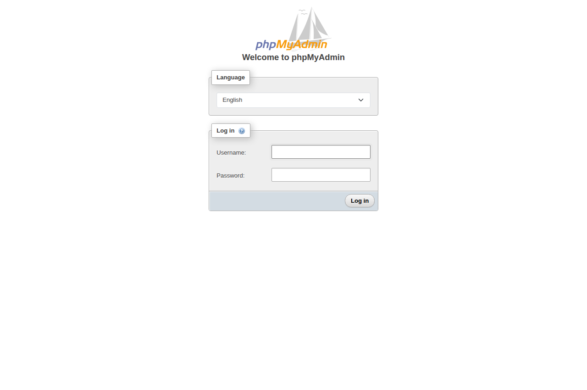
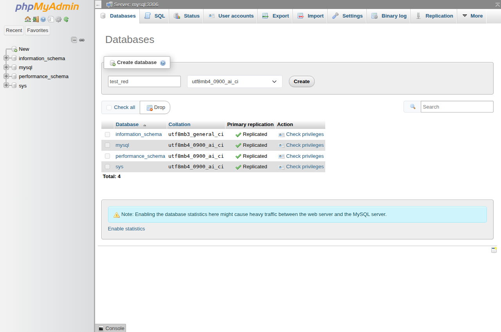
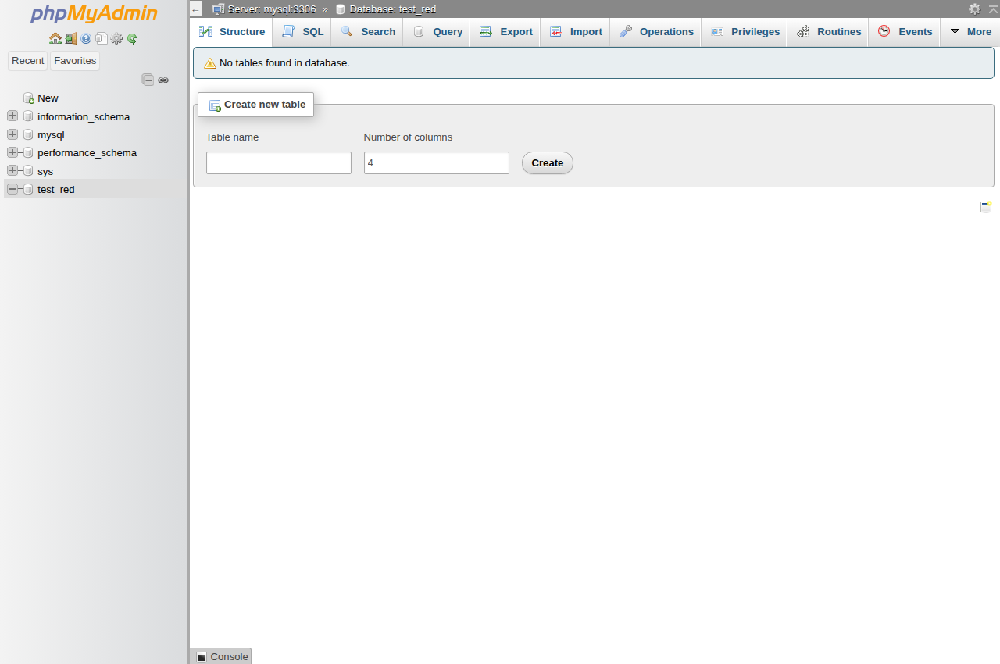

# Práctica 3: MySQL y phpMyAdmin en una red Docker

**Estudiante:** Alexis Patiño  
**Curso:** 4to ciclo  
**Fecha:** 2 de noviembre de 2026

## 1. Título

Comunicación entre un contenedor MySQL y un contenedor phpMyAdmin mediante una red personalizada de Docker.

## 2. Tiempo de duración

La duración real del despliegue y de la verificación se registra en `evidencias/inicio.txt` y `evidencias/fin.txt`. La instalación de herramientas y la redacción del informe se realizan fuera de ese intervalo.

## 3. Fundamentos

Docker permite ejecutar aplicaciones en contenedores separados. Una imagen incluye el software necesario para iniciar una aplicación, mientras que un contenedor representa su ejecución. Separar MySQL de phpMyAdmin permite identificar la responsabilidad de cada servicio: MySQL almacena y consulta la información, y phpMyAdmin proporciona una interfaz web para administrarla. Aunque ambos contenedores pueden ejecutarse en el mismo equipo, requieren una conexión de red para intercambiar solicitudes y respuestas.

MySQL es un sistema gestor de bases de datos relacional. Organiza los datos mediante bases, tablas y relaciones, y utiliza SQL para definir estructuras y consultar información. Para acceder al servidor se necesita una cuenta con permisos suficientes. En este laboratorio se utiliza una contraseña de demostración para la cuenta root. Esta cuenta permite crear la base de prueba; en un sistema real convendría utilizar cuentas con permisos limitados según las tareas de cada aplicación.

phpMyAdmin es una aplicación escrita en PHP que permite administrar MySQL desde el navegador. Sus formularios traducen acciones como crear una base de datos en operaciones enviadas al servidor. phpMyAdmin no sustituye a MySQL y tampoco almacena por sí mismo las bases administradas. Las credenciales introducidas en su pantalla de acceso corresponden al servidor MySQL. Por ello, si el nombre del servidor, el puerto o la contraseña son incorrectos, la interfaz no puede realizar las operaciones solicitadas.

Una red bridge personalizada permite conectar ambos contenedores dentro del mismo host Docker. Esta red incorpora resolución de nombres, de manera que phpMyAdmin puede localizar MySQL mediante el nombre de servicio `mysql`. No es necesario fijar una dirección IP, que podría cambiar al recrear el contenedor. La variable PMA_HOST indica ese destino y PMA_PORT establece el puerto interno 3306 utilizado por MySQL.

El navegador accede a phpMyAdmin a través de un puerto publicado. En este caso, el puerto 8080 del host se dirige al puerto 80 del contenedor web y se limita a la dirección local 127.0.0.1. MySQL no publica su puerto hacia el exterior: la comunicación con phpMyAdmin ocurre dentro de la red Docker. Además, localhost dentro de un contenedor se refiere a ese mismo contenedor; no representa al servidor MySQL ubicado en otro servicio.

Docker Compose permite describir esta configuración en un archivo declarativo. La comprobación de salud de MySQL evita iniciar la prueba antes de que el servidor pueda atender consultas. Finalmente, crear la base desde el formulario de phpMyAdmin y verificarla desde MySQL demuestra que existe comunicación funcional entre los servicios, más allá de que ambos contenedores aparezcan como iniciados.

```text
Navegador → 127.0.0.1:8080 → phpmyadmin_tas3:80
                                    │
                              red_tas3 (bridge)
                                    │
                               mysql:3306
                              mysql_tas3
```

**Figura 1.** Comunicación del navegador con phpMyAdmin y de phpMyAdmin con MySQL.

## 4. Conocimientos previos

- Imágenes, contenedores, puertos y redes Docker.
- Uso de terminal y archivos YAML.
- Autenticación y bases de datos MySQL.
- Navegación por formularios web.
- Publicación de informes Markdown en GitHub.

## 5. Objetivos a alcanzar

- Crear un contenedor MySQL con credenciales definidas.
- Crear un contenedor phpMyAdmin con el destino MySQL configurado.
- Conectar ambos servicios mediante la red bridge `red_tas3`.
- Crear `test_red` utilizando la interfaz de phpMyAdmin.
- Confirmar la existencia de la base mediante una consulta independiente a MySQL.

## 6. Equipo necesario

- Host Linux con Docker Engine y Docker Compose.
- Imágenes `mysql:8.4` y `phpmyadmin:5.2.3`.
- Navegador Chromium para acceder a phpMyAdmin.
- GitHub Actions para ejecutar el laboratorio aislado y conservar evidencias.

Se utiliza un runner temporal de GitHub Actions porque Docker no está instalado en el equipo Windows disponible. El navegador de la prueba se ejecuta en el mismo runner. Al finalizar se eliminan los servicios del laboratorio; las capturas y las verificaciones permanecen en el repositorio. No se mantiene una página pública de phpMyAdmin.

## 7. Material de apoyo

- [Imagen oficial MySQL](https://hub.docker.com/_/mysql).
- [Imagen oficial phpMyAdmin](https://hub.docker.com/_/phpmyadmin).
- [Redes bridge de Docker](https://docs.docker.com/engine/network/drivers/bridge/).
- [Plantilla de informe utilizada en la asignatura](https://github.com/maguaman2/informe-tendencias/blob/main/informe.md).

## 8. Procedimiento

### Paso 1. Definir las credenciales

Para reproducir la práctica en PowerShell, abrir una terminal en esta carpeta y definir una contraseña exclusiva del laboratorio:

```powershell
$env:MYSQL_ROOT_PASSWORD = 'Tas3_Laboratorio_2026'
```

En el runner Linux se define la misma variable en el flujo de trabajo. Es una credencial de demostración para servicios temporales, sin datos personales.

### Paso 2. Crear MySQL, phpMyAdmin y la red

El archivo [compose.yaml](compose.yaml) define dos contenedores: `mysql_tas3` y `phpmyadmin_tas3`. Ambos se conectan a `red_tas3`, creada explícitamente como red bridge por Compose.

```powershell
docker compose up -d --wait --wait-timeout 240
docker compose ps
docker network inspect red_tas3
```

MySQL utiliza `MYSQL_ROOT_PASSWORD` para inicializar la cuenta administrativa. `MYSQL_ROOT_HOST=%` permite que esa cuenta reciba la conexión desde el otro contenedor dentro de la red del laboratorio. MySQL no tiene un puerto publicado en el host.

phpMyAdmin utiliza `PMA_HOST=mysql` y `PMA_PORT=3306`. El nombre `mysql` corresponde al servicio dentro de la red personalizada. La autenticación se efectúa mediante el formulario web; no se configura acceso automático sin contraseña.

### Paso 3. Comprobar la comunicación por nombre

```powershell
docker exec phpmyadmin_tas3 getent hosts mysql
```

La salida debe resolver `mysql` a una dirección de la red Docker. [Ver resolución real](evidencias/dns.txt) y [configuración real de la red](evidencias/red.json).

### Paso 4. Acceder a phpMyAdmin

Abrir `http://127.0.0.1:8080` en el navegador del equipo que ejecuta los contenedores. Introducir usuario `root` y la contraseña definida anteriormente.



**Figura 2.** Pantalla real de acceso a phpMyAdmin antes de introducir las credenciales.

### Paso 5. Crear la base desde la interfaz

Después de iniciar sesión, abrir **Databases**, escribir `test_red` en el campo de creación de bases y pulsar **Create**. No se utiliza `MYSQL_DATABASE` ni una instrucción previa para crear esta base: se crea mediante el formulario web.



**Figura 3.** Formulario de phpMyAdmin con el nombre de la base de prueba.



**Figura 4.** Estado de la interfaz después de crear `test_red`.

La interacción reproducible del navegador se encuentra en [verificar_ui.py](verificar_ui.py). El script introduce las credenciales, abre la sección de bases y envía el formulario de creación; también guarda las capturas originales.

### Paso 6. Verificar en MySQL

La siguiente consulta comprueba de forma independiente que el servidor recibió y ejecutó la operación realizada desde phpMyAdmin:

```powershell
docker exec -it mysql_tas3 mysql -uroot -p -e "SHOW DATABASES LIKE 'test_red';"
```

El flujo automatizado verifica que exista exactamente una base con ese nombre. La consulta se ejecuta después de la operación web y no crea ninguna base. [Ver salida real de MySQL](evidencias/mysql.txt).

### Paso 7. Finalizar el laboratorio

```powershell
docker compose down -v
```

Este comando se usa al terminar las comprobaciones en el entorno desechable. Elimina los contenedores y la red del proyecto, junto con los volúmenes anónimos asociados. Esta práctica estudia redes y comunicación; no realiza una prueba de persistencia.

## 9. Resultados

La ejecución, las versiones y el estado final deben contrastarse con los archivos originales de [evidencias](evidencias/). Las capturas proceden del navegador que accedió a los contenedores del runner.

**Conclusión:** una red bridge personalizada permite que phpMyAdmin localice MySQL por nombre de servicio. La configuración del destino y las credenciales permiten administrar el servidor desde la interfaz web. Crear una base desde esa interfaz y consultarla directamente en MySQL permite comprobar el recorrido completo de la solicitud.

El audio personal de al menos 60 segundos se adjunta por separado a la plataforma de la asignatura; no se incluye un guion ni un MP3 en GitHub.

## 10. Bibliografía

Docker, Inc. (s. f.). *Bridge network driver*. Docker Docs. https://docs.docker.com/engine/network/drivers/bridge/

Docker Official Images. (s. f.). *mysql*. Docker Hub. https://hub.docker.com/_/mysql

phpMyAdmin. (s. f.). *phpmyadmin: Docker Official Image*. Docker Hub. https://hub.docker.com/_/phpmyadmin

Maguaman2. (s. f.). *informe-tendencias* [Plantilla de informe]. GitHub. https://github.com/maguaman2/informe-tendencias